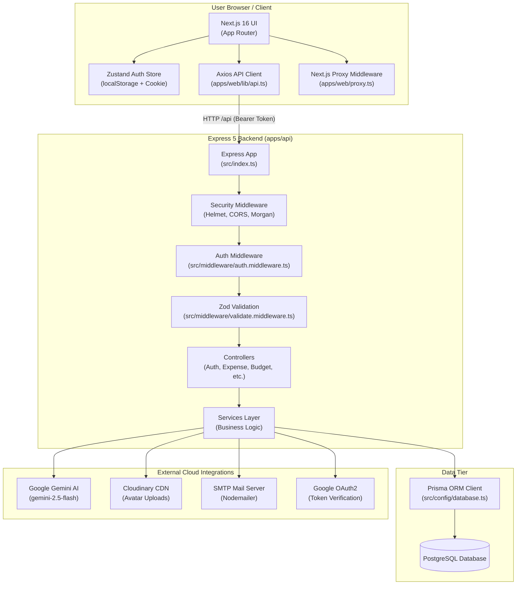
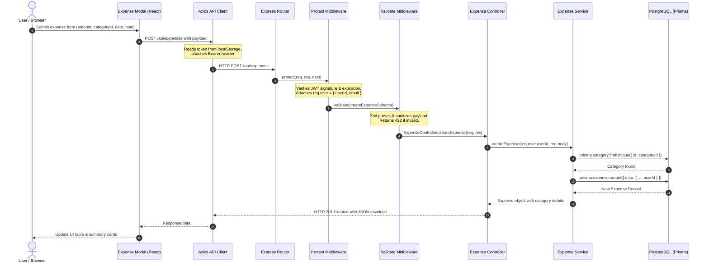

# Architecture Overview

This document outlines the architectural structure, component responsibilities, data flow, and verifiable design decisions of the SpendWise application.

---

## 1. System Components & Responsibilities

SpendWise is divided into three primary tiers: the web frontend, the backend REST API, and the PostgreSQL database, supported by third-party cloud services.

```
┌─────────────────────────────────────────────────────────────┐
│                       Frontend Tier                         │
│   Next.js 16 (App Router) • React 19 • Tailwind CSS v4      │
│   Zustand Auth Store • Chart.js • Axios API Client          │
└──────────────────────────────┬──────────────────────────────┘
                               │ HTTPS (JSON / JWT)
                               ▼
┌─────────────────────────────────────────────────────────────┐
│                        Backend Tier                         │
│        Node.js • Express 5 • Prisma ORM • Zod Validation     │
│   Routes ➔ Middlewares (Auth/Validate) ➔ Controllers ➔      │
│   Services (AI/Analytics/Auth/Budget/Expense/Export)        │
└──────────────┬───────────────┬───────────────┬──────────────┘
               │               │               │
      Prisma   ▼      HTTPS    ▼      SMTP     ▼
┌──────────────┐ ┌─────────────┐ ┌─────────────┐
│  PostgreSQL  │ │Google Gemini│ │  Nodemailer │
│   Database   │ │ (AI Insight)│ │(Password Res│
└──────────────┘ └─────────────┘ └─────────────┘
                        ▲
                        │ HTTPS
                 ┌─────────────┐
                 │ Cloudinary  │
                 │(User Avatar)│
                 └─────────────┘
```

### Component Breakdown

| Component | Repository Path | Technology | Primary Responsibilities |
| :--- | :--- | :--- | :--- |
| **Frontend Web Application** | `apps/web/` | Next.js 16, React 19, TypeScript | Server-rendered and client-rendered UI pages, dashboard charts, budget forms, expense tracking tables, client-side route guarding via `proxy.ts`. |
| **Backend API Service** | `apps/api/` | Express 5, TypeScript | REST API endpoints, request validation via Zod, authentication enforcement via JWT, financial analytics, CSV/PDF report generation. |
| **Database & ORM** | `apps/api/prisma/` | PostgreSQL, Prisma 5.22 | Persistent storage of users, categories, expenses, and budgets. Database queries and relational integrity. |
| **AI Advisor Service** | `apps/api/src/services/ai.service.ts` | `@google/generative-ai` | Summarizes recent 30-day user expenses and queries Google Gemini (`gemini-2.5-flash` / `gemini-1.5-flash`) for tailored financial tips in JSON. |
| **Media Storage** | `apps/api/src/config/cloudinary.ts` | Cloudinary SDK | Stores uploaded user profile avatars with face-detection thumbnail transformations. |
| **Email Service** | `apps/api/src/config/mailer.ts` | Nodemailer | Sends password reset emails with signed temporary reset tokens via SMTP. |
| **Google Identity** | `apps/api/src/services/auth.service.ts` | `google-auth-library` | Validates Google ID tokens for one-click authentication. |

---

## 2. Monorepo Directory Structure

The repository is structured as an npm workspaces monorepo:

```text
spendwise/
├── .github/
│   └── workflows/
│       └── ci.yml             # GitHub Actions CI workflow (test backend, build frontend)
├── api/                       # Vercel serverless function bridge
│   ├── [...slug].ts           # Wildcard serverless route
│   └── index.ts               # Re-exports Express app from apps/api
├── apps/
│   ├── api/                   # Backend Express service
│   │   ├── prisma/            # Prisma schema, migrations, and seed script
│   │   ├── src/
│   │   │   ├── config/        # Environment validator, DB client, Cloudinary, Mailer
│   │   │   ├── controllers/   # HTTP request handling and response dispatching
│   │   │   ├── middleware/    # Auth (JWT), validation (Zod), error and 404 handling
│   │   │   ├── routes/        # Express router definitions
│   │   │   ├── services/      # Business logic and Prisma database access
│   │   │   ├── utils/         # JWT helpers, bcrypt hashing, JSON response envelope
│   │   │   ├── validators/    # Zod input schemas
│   │   │   ├── index.ts       # Express app setup, middleware, and route mounting
│   │   │   └── server.ts      # Local HTTP listener entry point
│   │   ├── Dockerfile         # Multi-stage production container build
│   │   └── package.json       # Backend dependencies and scripts
│   │
│   └── web/                   # Frontend Next.js application
│       ├── app/               # Next.js App Router (pages and layouts)
│       │   ├── (auth)/        # Public auth routes (login, register, forgot-password)
│       │   ├── (dashboard)/   # Authenticated routes (dashboard, expenses, budgets, insights, export, settings)
│       │   ├── layout.tsx     # Root HTML layout and font loading
│       │   └── page.tsx       # Marketing landing page
│       ├── components/        # Reusable UI widgets, charts, tables, and modals
│       ├── hooks/             # Custom React data fetching hooks (useExpenses, useBudgets, etc.)
│       ├── lib/               # Axios API client (api.ts) and utility helpers (utils.ts)
│       ├── store/             # Zustand global state (useAuthStore.ts)
│       ├── proxy.ts           # Next.js 16 route protection middleware
│       └── package.json       # Frontend dependencies and scripts
│
├── docs/                      # Developer and architectural documentation
├── docker-compose.yml         # Container orchestrator
├── package.json               # Root monorepo configuration and workspace scripts
├── tsconfig.json              # Root TypeScript base configuration
├── vercel.json                # Vercel deployment rewrite rules
└── README.md                  # Project overview
```

---

## 3. Communication Patterns

### Client-to-Backend Communication
- **Protocol**: HTTP/1.1 over HTTPS in production, plain HTTP in local development.
- **Client**: Single configured Axios instance (`apps/web/lib/api.ts`).
- **Authentication**: JWT tokens stored in browser `localStorage` and `spendwise_token` cookie, attached as an HTTP `Authorization: Bearer <token>` header on every outgoing API request.
- **Payload Format**: `application/json` for requests and responses, with binary streaming for PDF/CSV report downloads.
- **Token Expiration Handling**: Axios response interceptor intercepts HTTP 401 responses on non-auth endpoints, deletes local tokens, and redirects the browser to `/login`.

### Backend-to-Database Communication
- **Protocol**: PostgreSQL TCP connection pool managed by Prisma Client (`apps/api/src/config/database.ts`).
- **Connection URL**: Configured via the `DATABASE_URL` environment variable.

---

## 4. Architecture Diagram



---

## 5. Representative Request Flow: Creating an Expense

The following sequence diagram traces the complete lifecycle of logging an expense:



---

## 6. Verifiable Architectural Decisions

The following architectural choices are established directly in the repository code:

1. **Strict Monorepo Separation (`apps/api` and `apps/web`)**:
   - The frontend and backend run as distinct workspaces within an npm monorepo.
   - Code is not directly imported across workspaces at build time; communication is strictly through the HTTP REST API.

2. **Stateless JWT Authentication**:
   - User authentication does not utilize server-side sessions or a database session table.
   - Tokens contain the user's `userId` and `email` signed with `JWT_SECRET`.
   - Logging out on the server (`POST /api/auth/logout`) is a no-op that returns a success confirmation; token invalidation is managed client-side by deleting the stored token.

3. **Three-Tier Backend Separation (Routes ➔ Controllers ➔ Services)**:
   - Routes define endpoints and middleware chains.
   - Controllers handle HTTP semantics (status codes, parsing headers/queries).
   - Services contain domain logic and execute Prisma database operations. Controllers do not query Prisma directly.

4. **Multi-Target Deployment Compatibility**:
   - For standalone environments (Node.js or Docker), `apps/api/src/server.ts` binds an HTTP listener on `PORT`.
   - For serverless environments (Vercel), `api/index.ts` exports the Express `app` directly for consumption by Vercel serverless function runners.
