# Database Guide

This document describes the database design, data models, constraints, relationships, seeding, and migration processes in the SpendWise application.

---

## 1. Database Technology & ORM

- **Database Engine**: PostgreSQL
- **Object-Relational Mapping (ORM)**: [Prisma ORM v5.22.0](https://www.prisma.io/)
- **Schema Definition**: [`apps/api/prisma/schema.prisma`](file:///d:/spendwise/apps/api/prisma/schema.prisma)
- **Binary Targets**: `native` (local development) and `rhel-openssl-3.0.x` (cloud/container environments).

```prisma
datasource db {
  provider = "postgresql"
  url      = env("DATABASE_URL")
}
```

---

## 2. Entity-Relationship (ER) Diagram

```mermaid
erDiagram
    User ||--o{ Expense : "creates (1:N)"
    User ||--o{ Budget : "sets (1:N)"
    Category ||--o{ Expense : "classifies (1:N)"
    Category ||--o{ Budget : "limits (1:N)"

    User {
        Int id PK
        String name
        String email UK
        String passwordHash "nullable (OAuth)"
        String googleId UK "nullable"
        String authProvider "default 'local'"
        String currency "default 'LKR'"
        String resetTokenHash "nullable"
        DateTime resetTokenExpiry "nullable"
        String avatarUrl "nullable"
        Boolean notifyBudgetAlerts "default true"
        Boolean notifyWeeklySummary "default false"
        Boolean notifyMonthlyReport "default true"
        DateTime createdAt
        DateTime updatedAt
    }

    Category {
        Int id PK
        String name UK
        String icon
        String color
        Int order "default 0"
    }

    Expense {
        Int id PK
        Decimal amount "Decimal(10,2)"
        String note "nullable"
        DateTime date
        Int userId FK
        Int categoryId FK
        DateTime createdAt
        DateTime updatedAt
    }

    Budget {
        Int id PK
        Decimal amount "Decimal(10,2)"
        Int month
        Int year
        Int userId FK
        Int categoryId FK
        DateTime createdAt
        DateTime updatedAt
    }
```



---

## 3. Data Models & Constraints

### 3.1. `User` (Mapped to `users` table)

Stores user accounts, authentication credentials, notification preferences, and display currency.

| Column | Type | Attributes / Constraints | Description |
| :--- | :--- | :--- | :--- |
| `id` | `Int` | `@id`, `@default(autoincrement())` | Primary key. |
| `name` | `String` | Not Null | User's full display name. |
| `email` | `String` | `@unique`, Not Null | User's email address (used for login and password resets). |
| `passwordHash` | `String?` | Nullable | Bcrypt hash of password. Nullable for users registered via Google OAuth. |
| `googleId` | `String?` | `@unique`, Nullable | Unique Google identifier (`sub` claim) from Google ID tokens. |
| `authProvider` | `String` | `@default("local")` | Identity provider: `"local"` or `"google"`. |
| `currency` | `String` | `@default("LKR")` | Display currency code (e.g., `"LKR"`, `"USD"`, `"EUR"`). |
| `resetTokenHash` | `String?` | Nullable | SHA-256 hash of temporary password reset token. |
| `resetTokenExpiry` | `DateTime?` | Nullable | Expiration timestamp (15 minutes from issue) for password reset. |
| `avatarUrl` | `String?` | Nullable | Cloudinary URL for profile picture. |
| `notifyBudgetAlerts` | `Boolean` | `@default(true)` | Toggle for budget threshold notifications. |
| `notifyWeeklySummary` | `Boolean` | `@default(false)` | Toggle for weekly summary emails. |
| `notifyMonthlyReport` | `Boolean` | `@default(true)` | Toggle for monthly financial report generation. |
| `createdAt` | `DateTime` | `@default(now())` | Account creation timestamp. |
| `updatedAt` | `DateTime` | `@updatedAt` | Automatic update timestamp. |

### 3.2. `Category` (Mapped to `categories` table)

Read-only lookup table representing expense and budget categories.

| Column | Type | Attributes / Constraints | Description |
| :--- | :--- | :--- | :--- |
| `id` | `Int` | `@id`, `@default(autoincrement())` | Primary key. |
| `name` | `String` | `@unique`, Not Null | Category name (e.g., `"Food"`, `"Transport"`). |
| `icon` | `String` | Not Null | Display emoji icon (e.g., `"🍔"`, `"🚌"`). |
| `color` | `String` | Not Null | Hex color string for chart representation (e.g., `"#FF6384"`). |
| `order` | `Int` | `@default(0)` | Integer used for UI ordering. |

### 3.3. `Expense` (Mapped to `expenses` table)

Records individual monetary transactions logged by users.

| Column | Type | Attributes / Constraints | Description |
| :--- | :--- | :--- | :--- |
| `id` | `Int` | `@id`, `@default(autoincrement())` | Primary key. |
| `amount` | `Decimal` | `@db.Decimal(10, 2)`, Not Null | Transaction value with 2 decimal places. |
| `note` | `String?` | Nullable | Optional user description or note (max 255 chars in validator). |
| `date` | `DateTime` | Not Null | Date when the expense occurred. |
| `userId` | `Int` | FK ➔ `users.id` (`onDelete: Cascade`) | Owner of the expense. |
| `categoryId` | `Int` | FK ➔ `categories.id` | Associated category. |
| `createdAt` | `DateTime` | `@default(now())` | Record insertion timestamp. |
| `updatedAt` | `DateTime` | `@updatedAt` | Record update timestamp. |

### 3.4. `Budget` (Mapped to `budgets` table)

Defines monthly spending caps per category for a user.

| Column | Type | Attributes / Constraints | Description |
| :--- | :--- | :--- | :--- |
| `id` | `Int` | `@id`, `@default(autoincrement())` | Primary key. |
| `amount` | `Decimal` | `@db.Decimal(10, 2)`, Not Null | Maximum budgeted amount for the month. |
| `month` | `Int` | Not Null | Target month (1 to 12). |
| `year` | `Int` | Not Null | Target calendar year (e.g., 2026). |
| `userId` | `Int` | FK ➔ `users.id` (`onDelete: Cascade`) | Owner of the budget. |
| `categoryId` | `Int` | FK ➔ `categories.id` | Category being budgeted. |
| `createdAt` | `DateTime` | `@default(now())` | Record insertion timestamp. |
| `updatedAt` | `DateTime` | `@updatedAt` | Record update timestamp. |

#### Compound Constraint
The `budgets` table enforces a compound unique constraint:
```prisma
@@unique([userId, categoryId, month, year])
```
This guarantees that a user cannot create duplicate budget allocations for the same category in the same month and year.

---

## 4. User Ownership & Data Isolation

Data isolation is enforced at two distinct levels:

1. **Foreign Key Constraints (`onDelete: Cascade`)**:
   Both `expenses` and `budgets` reference `users.id` with `onDelete: Cascade`. If a user deletes their account (`DELETE /api/auth/me`), PostgreSQL automatically cascades the deletion to remove all associated expenses and budgets.

2. **Application-Layer Tenant Scoping**:
   All database queries in [`apps/api/src/services/expense.service.ts`](file:///d:/spendwise/apps/api/src/services/expense.service.ts) and [`apps/api/src/services/budget.service.ts`](file:///d:/spendwise/apps/api/src/services/budget.service.ts) filter by the authenticated user's `userId`:
   ```typescript
   // Example from expense.service.ts
   const expense = await prisma.expense.findFirst({
       where: {
           id: expenseId,
           userId, // Enforces user ownership
       },
   })
   ```
   If a record exists but belongs to another user, the query returns `null`, and the service raises a generic `Expense not found` error resulting in an HTTP 404 response.

---

## 5. Migration and Seeding Commands

### Schema Synchronization (`db push`)
To synchronize the active Prisma schema with your PostgreSQL database:

```bash
cd apps/api
npx prisma db push
```

> [!WARNING]
> **Migration History Note**: The directory `apps/api/prisma/migrations/20260501021038_init/` contains a historical SQL file written in Microsoft SQL Server T-SQL syntax. Running `prisma migrate dev` or `prisma migrate deploy` will produce syntax errors against PostgreSQL. For this reason, the repository and its CI workflow use `npx prisma db push`.

### Seeding Default Categories
To populate the database with default spending categories:

```bash
cd apps/api
npm run seed
```

This runs `apps/api/prisma/seed.ts`, which inserts the following 8 categories:

| Category | Icon | Hex Color | Order |
| :--- | :---: | :---: | :---: |
| Education | 📚 | `#FFCE56` | 1 |
| Food | 🍔 | `#FF6384` | 2 |
| Health | 💊 | `#9966FF` | 3 |
| Transport | 🚌 | `#36A2EB` | 4 |
| Utilities | 💡 | `#FF9F40` | 5 |
| Entertainment | 🎮 | `#4BC0C0` | 6 |
| Shopping | 🛍️ | `#FF6B6B` | 7 |
| Other | 📦 | `#C9CBCF` | 8 |

Categories are inserted using `prisma.category.upsert({ where: { name } })`, ensuring safe idempotency if the seed command is executed multiple times.
