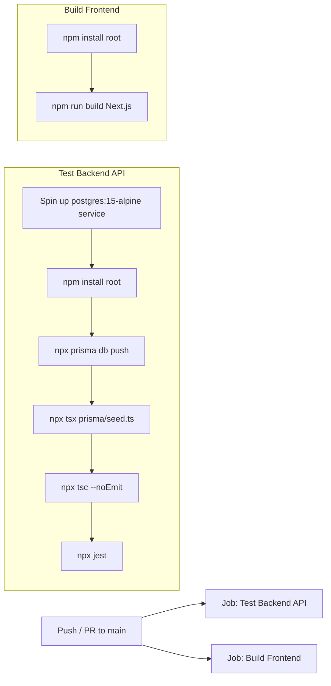

# Development & Testing Guide

This document describes the commands, development conventions, feature implementation steps, test architecture, and continuous integration workflows for SpendWise.

---

## 1. Available Commands

SpendWise provides scripts at both the root monorepo level and within individual package directories.

### Root Workspace Commands

| Command | Action | Description |
| :--- | :--- | :--- |
| `npm run dev:api` | `nodemon ... apps/api/src/server.ts` | Starts the Express backend on port 5000 with hot-reloading on TypeScript changes. |
| `npm run dev:web` | `next dev` | Starts the Next.js frontend on port 3000. |
| `npm run build:api` | `tsc` | Compiles backend TypeScript code into `apps/api/dist/`. |
| `npm run build:web` | `next build` | Produces an optimized Next.js production bundle. |

### Backend Commands (`cd apps/api`)

| Command | Script / Underlying Tool | Description |
| :--- | :--- | :--- |
| `npm run dev` | `nodemon --watch src --ext ts --exec tsx src/server.ts` | Starts backend in development mode with live restart. |
| `npm run build` | `tsc` | Transpiles TypeScript files to JavaScript. |
| `npm start` | `node dist/index.js` | Runs compiled JavaScript server in production. |
| `npm test` | `dotenv -e .env.test -- jest` | Executes test suite using test environment variables (`.env.test`). |
| `npm run test:watch` | `jest --watch` | Runs Jest in interactive watch mode. |
| `npm run test:coverage`| `jest --coverage` | Generates Jest code coverage reports. |
| `npm run seed` | `tsx prisma/seed.ts` | Seeds default categories into the database. |

### Frontend Commands (`cd apps/web`)

| Command | Script / Underlying Tool | Description |
| :--- | :--- | :--- |
| `npm run dev` | `next dev` | Starts Next.js development server. |
| `npm run build` | `next build` | Generates static and dynamic production artifacts. |
| `npm start` | `next start` | Starts Next.js production server. |
| `npm run lint` | `eslint` | Runs ESLint over frontend source code. |

---

## 2. Code Organization & Patterns

SpendWise enforces a strict separation of concerns:

```
[HTTP Request] 
      │
      ▼
1. Routes (`routes/`)            --> Defines HTTP method, path, and middleware chain
      │
      ▼
2. Middleware (`middleware/`)    --> Enforces JWT authentication (`protect`) and Zod schema (`validate`)
      │
      ▼
3. Controllers (`controllers/`)  --> Extracts parameters, calls services, sends standard response envelope
      │
      ▼
4. Services (`services/`)        --> Executes business logic, external API calls, and Prisma DB queries
      │
      ▼
5. Prisma ORM (`config/database`) --> Executes SQL operations against PostgreSQL
```

### Conventions
1. **Never query the database in controllers**: Controllers must delegate to service functions.
2. **Never store plain passwords**: Always call `hashPassword()` before persisting credentials.
3. **Always scope data by user**: Any query fetching, updating, or deleting expenses or budgets must include `where: { userId: req.user.userId }`.
4. **Use standardized response helpers**: Always dispatch responses using `sendSuccess(res, data, message, statusCode)` or `sendError(res, message, statusCode, errors)` from [`apps/api/src/utils/response.ts`](file:///d:/spendwise/apps/api/src/utils/response.ts).

---

## 3. How to Add a New Feature

Follow this step-by-step workflow when adding a new domain feature (e.g., "Goals"):

### Step 1: Define Database Models (if persistent data is required)
1. Add the model to [`apps/api/prisma/schema.prisma`](file:///d:/spendwise/apps/api/prisma/schema.prisma):
   ```prisma
   model Goal {
     id        Int      @id @default(autoincrement())
     title     String
     target    Decimal  @db.Decimal(10, 2)
     userId    Int
     user      User     @relation(fields: [userId], references: [id], onDelete: Cascade)
     createdAt DateTime @default(now())
   }
   ```
2. Push the schema and regenerate the Prisma client:
   ```bash
   cd apps/api
   npx prisma db push
   npx prisma generate
   ```

### Step 2: Create Zod Validation Schemas
Create `apps/api/src/validators/goal.validator.ts`:
```typescript
import { z } from 'zod'

export const createGoalSchema = z.object({
    title: z.string().min(1, 'Title is required').max(100),
    target: z.number().positive('Target must be positive'),
})
export type CreateGoalInput = z.infer<typeof createGoalSchema>
```

### Step 3: Implement the Service Layer
Create `apps/api/src/services/goal.service.ts`:
```typescript
import prisma from '../config/database'
import { CreateGoalInput } from '../validators/goal.validator'

export async function createGoal(userId: number, data: CreateGoalInput) {
    return prisma.goal.create({
        data: { ...data, userId },
    })
}
```

### Step 4: Implement the Controller Layer
Create `apps/api/src/controllers/goal.controller.ts`:
```typescript
import { Request, Response } from 'express'
import * as GoalService from '../services/goal.service'
import { sendSuccess, sendError } from '../utils/response'

export async function createGoal(req: Request, res: Response): Promise<void> {
    try {
        const goal = await GoalService.createGoal(req.user!.userId, req.body)
        sendSuccess(res, { goal }, 'Goal created successfully', 201)
    } catch (error) {
        sendError(res, 'Failed to create goal', 400)
    }
}
```

### Step 5: Register Route and Mount in Router
Create `apps/api/src/routes/goal.routes.ts`:
```typescript
import { Router } from 'express'
import { protect } from '../middleware/auth.middleware'
import { validate } from '../middleware/validate.middleware'
import { createGoalSchema } from '../validators/goal.validator'
import * as GoalController from '../controllers/goal.controller'

const router = Router()
router.use(protect)
router.post('/', validate(createGoalSchema), GoalController.createGoal)
export default router
```
Mount in `apps/api/src/routes/index.ts`:
```typescript
import goalRoutes from './goal.routes'
router.use('/goals', goalRoutes)
```

### Step 6: Write Automated Tests
Add test cases in `apps/api/src/__tests__/integration/goal.test.ts`.

---

## 4. Test Architecture & Coverage

SpendWise utilizes **Jest** (`ts-jest`) and **Supertest** for testing.

### Test Configuration (`apps/api/jest.config.js`)
* Matches all files named `*.test.ts` in `apps/api/src/__tests__/`.
* Configures `maxWorkers: 1` to execute test suites sequentially, preventing database race conditions during test data cleanup.
* Uses `forceExit: true` to prevent process hanging due to open Prisma database connections.

### Test Suites in Codebase

#### 1. Unit Tests (`apps/api/src/__tests__/unit/`)
- **`hash.test.ts`**: Verifies `hashPassword()` creates bcrypt hashes with unique salts, rejects incorrect passwords, and validates correct matches.
- **`jwt.test.ts`**: Verifies `signToken()` generates 3-part JWTs, `verifyToken()` extracts original payload, and corrupted/tampered tokens throw errors.

#### 2. Integration Tests (`apps/api/src/__tests__/integration/`)
- **`auth.test.ts`**: Tests full HTTP registration and login lifecycles via Supertest:
  - User registration success (201) and duplicate email conflict (409).
  - Validation rejections for short passwords and malformed emails (422).
  - Login credential validation (200) and incorrect password rejection (401).
  - Protected profile route access with and without Bearer tokens (200 vs 401).
- **`expense.test.ts`**: Tests expense CRUD lifecycles:
  - Authenticated vs unauthenticated expense creation (201 vs 401).
  - Validation rejections for negative amounts (422) and nonexistent categories (400).
  - Data isolation: verifies User B receives a 404 Not Found when attempting to query an expense created by User A.
  - Expense update and permanent deletion.

---

## 5. Continuous Integration (GitHub Actions)

The CI pipeline is defined in [`.github/workflows/ci.yml`](file:///d:/spendwise/.github/workflows/ci.yml) and runs on all pushes and pull requests to `main`.



### CI Pipeline Steps
1. **Backend Job (`test-backend`)**:
   - Launches a transient PostgreSQL 15 container service (`postgres:15-alpine`) on port 5432 with health check probes.
   - Installs dependencies from the monorepo root using `npm install`.
   - Synchronizes database schema using `npx prisma db push`.
   - Seeds categories using `npx tsx prisma/seed.ts`.
   - Type-checks backend TypeScript without emitting files: `npx tsc --noEmit`.
   - Runs Jest test suites using the containerized PostgreSQL database.
2. **Frontend Job (`test-frontend`)**:
   - Sets up Node.js 20 with npm caching.
   - Installs dependencies from root.
   - Executes `npm run build` in `apps/web` with `NEXT_PUBLIC_API_URL` to confirm production compilation passes.
